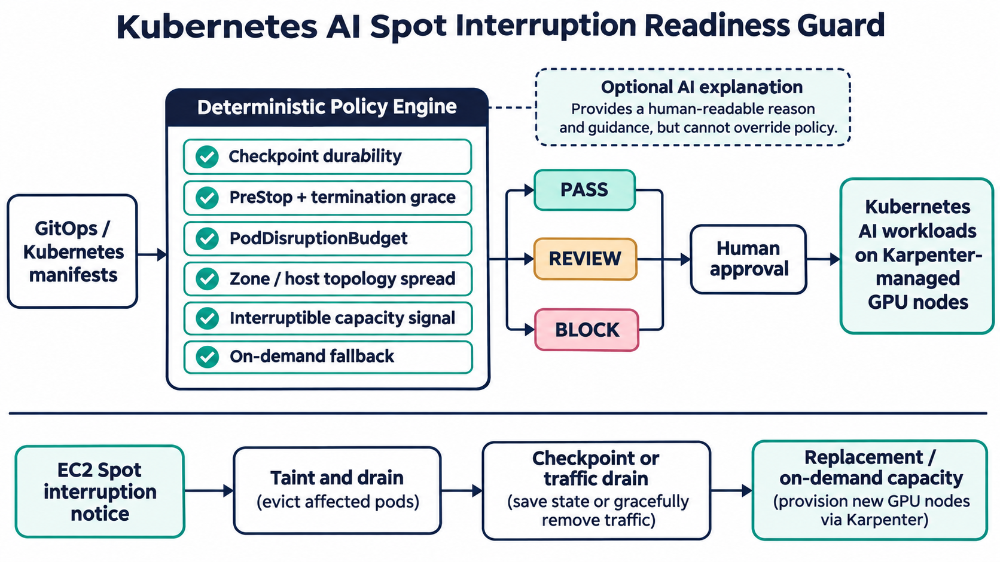

# Kubernetes AI Spot Interruption Readiness Guard

A deterministic pre-merge policy gate for AI workloads that use interruptible Kubernetes capacity. It catches configurations that turn a two-minute cloud interruption warning into lost training work or inference downtime.



## Why this matters now

AI platform teams are under pressure to control GPU cost without weakening reliability. Current AI-platform roles repeatedly ask for Kubernetes, Terraform, observability, cost control, and production reliability together. AWS documents a best-effort two-minute EC2 Spot warning; Kubernetes and Karpenter provide graceful termination, eviction, disruption budgets, and replacement workflows, but workload owners must configure their pods to use them safely.

This project turns those requirements into explainable PASS, REVIEW, or BLOCK results. An optional AI layer may translate findings, but it cannot change policy outcomes.

## What it checks

- durable, frequent checkpoints for training workloads
- `preStop` hooks and at least 120 seconds of termination grace
- readiness probes and matching PodDisruptionBudgets
- topology spread across availability zones and hosts
- an interruption handler declaration
- on-demand fallback without hard spot-only affinity
- at least two replicas for interruptible inference

## Quick start

```bash
python -m venv .venv
source .venv/bin/activate
pip install -e . pytest
pytest -q
spot-readiness-guard samples/compliant-workload.yaml
```

Exit code `0` means PASS. REVIEW and BLOCK return `2`, which makes the CLI suitable for CI and GitOps pull-request checks.

## Operational workflow

1. A pull request changes an AI workload manifest.
2. The guard correlates workloads and disruption budgets.
3. Deterministic rules emit evidence and a decision.
4. A human reviews exceptions; AI may explain but never override.
5. Only approved manifests reach the GitOps reconciler.

## Measurable outcomes

Suggested evaluation criteria are policy coverage, blocked unsafe releases, false-positive rate, checkpoint age at interruption, percentage of interruptions recovered without operator action, lost accelerator-minutes, and recovery time. A production target could be 100% policy coverage, less than 5% false positives, and recovery within the configured termination window.

## Security and failure modes

The tool is offline and makes no cluster or cloud mutation. It does not read secrets, call a model, or trust free-form AI output. Known limits: static manifests cannot prove that checkpoint code works, cloud interruption notices are best effort, and a declared fallback does not prove spare quota. Validate checkpoint restore, capacity, and drain behavior with controlled game days.

## Interview positioning

Use this project to discuss the cost/reliability trade-off of spot GPUs, Kubernetes eviction semantics, fail-closed policy design, deterministic AI guardrails, cross-resource analysis, and measurable SRE outcomes. The key design choice is keeping enforcement deterministic while reserving AI for non-authoritative explanation.

See [research](docs/research.md) and [safe deployment guidance](docs/deployment.md).
