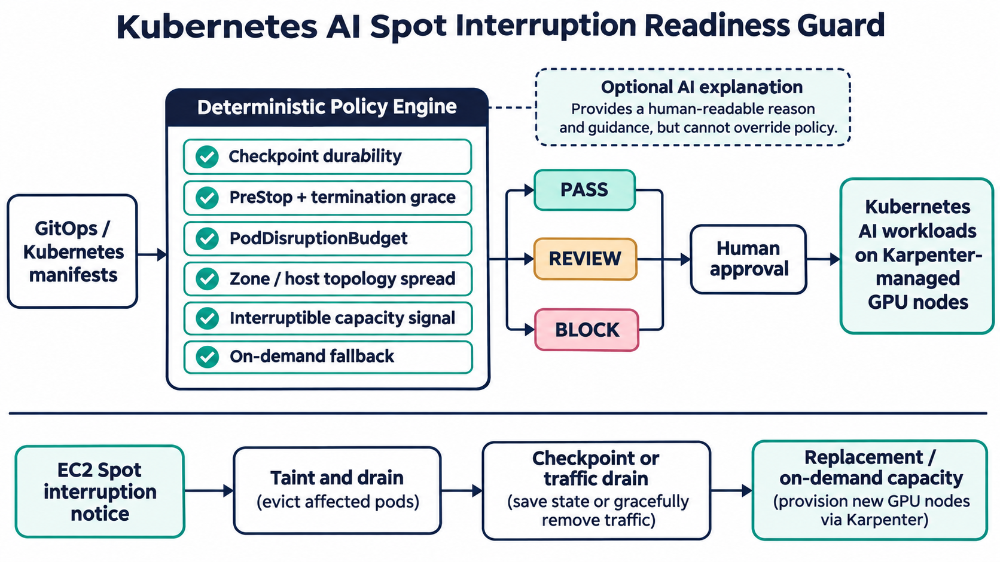

# Making Kubernetes AI Workloads Ready for Spot Interruptions

Interruptible accelerator capacity is attractive because AI compute is expensive. The production risk is that savings disappear when a training job loses state or an inference service drops traffic during eviction.

AWS says EC2 Spot warnings are best effort and normally provide only two minutes. Kubernetes and Karpenter supply the primitives for graceful termination, eviction, replacement, and disruption budgets, but those controls must be present in each workload.

## Architecture and implementation

The guard parses multi-document YAML, correlates Deployments, StatefulSets, Jobs, and PodDisruptionBudgets, then applies deterministic rules. It checks checkpoint durability, lifecycle hooks, grace periods, readiness, topology spread, fallback capacity, interruption handling, and inference redundancy. Results are machine-readable PASS, REVIEW, or BLOCK decisions. AI is deliberately outside the enforcement path and can only explain evidence.

## Validation and deployment

The suite covers compliant manifests and failures for short grace periods, missing hooks, missing budgets, weak topology spread, hard spot affinity, missing handlers, single-replica inference, and missing training checkpoints. GitHub Actions runs tests and evaluates the compliant sample. Deploy it first in report-only pull-request checks, measure false positives, then enforce BLOCK with documented, expiring exceptions.

Security rests on minimal permissions and deterministic behavior: the tool is offline, reads no secrets, calls no model, and performs no cluster mutation. Static checks still need controlled interruption game days to prove checkpoint restore, drain behavior, quota, and replacement latency.

## Outcomes and trade-offs

Useful measures include policy coverage, unsafe releases blocked, checkpoint age, lost accelerator-minutes, recovery time, automated recovery rate, and false positives. The trade-off is clear: stronger availability and fallback capacity can reduce spot savings, so reliability tiers should be explicit.

For interviews, this project demonstrates Kubernetes operations, GitOps policy, SRE failure-mode thinking, AI workload economics, testable automation, and a deliberate boundary between AI assistance and deterministic control.

Repository: https://github.com/ohjeffkuston/kubernetes-ai-spot-readiness-guard
